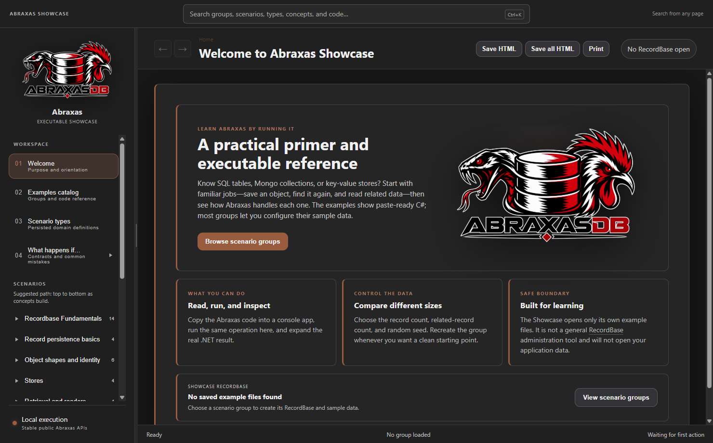
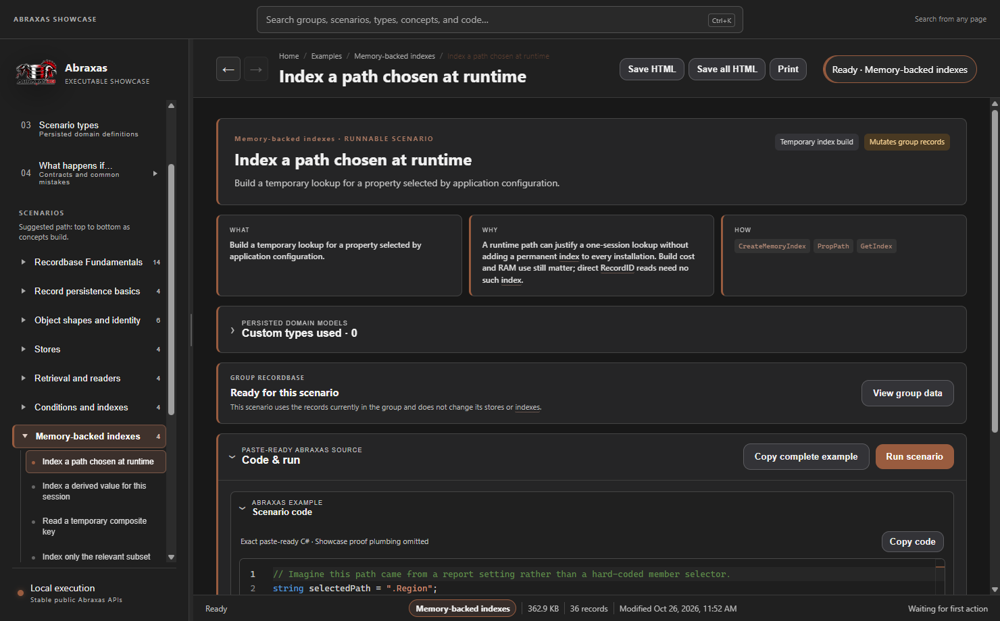

# Abraxas Showcase

A Windows / WinForms / WebView2 walkthrough of public AbraxasDB APIs. The app contains runnable OSS lessons, complete copyable C# programs, graph inspection, indexes, selected-value reads, and memory-backed index examples.



## Download and run

Download the Windows x64 ZIP from [Releases](https://github.com/alt160/AbraxasDB.Showcase/releases), extract the entire ZIP to a writable folder, and run `AbraxasShowcase.exe`.

The ZIP does not include .NET. Install the **.NET 10 Windows Desktop Runtime, x64**, from [Microsoft's .NET 10 downloads](https://dotnet.microsoft.com/en-us/download/dotnet/10.0) if it is not already installed. Choose **Desktop Runtime** rather than the standalone console or ASP.NET runtime. The app also requires [Microsoft Edge WebView2 Evergreen Runtime](https://developer.microsoft.com/en-us/microsoft-edge/webview2/). Neither prerequisite is installed automatically by this ZIP. If Windows prompts for .NET at launch, install the x64 Desktop Runtime and run the app again.

Run `AbraxasShowcase.exe --data "T:\AbraxasShowcaseDemo"` to choose a dedicated laboratory. Group setup can replace data inside its app-owned laboratory after confirmation; do not use an application database as a laboratory. The default laboratory is under the current user's LocalApplicationData directory.

Commercial feature examples remain readable. OSS execution shows an edition notice and does not run commercial engine code. Private verification, named-pipe UI probes, profiling tools and commercial implementations are excluded from this distribution.

`--export-examples --output "T:\AbraxasExamples"` writes standalone example programs to a chosen new output folder. Commercial-only examples are marked as requiring the separate commercial edition.



The screenshots show the actual OSS app. All 78 OSS scenarios passed against the public AbraxasDB 1.0.1 package; the four commercial examples remain readable and are gated from execution.

## Build from source

Use the .NET 10 SDK and run:

```powershell
dotnet build src/AbraxasShowcase/AbraxasShowcase.csproj -c Release -p:Platform=x64
```

This project consumes the public [AbraxasDB](https://github.com/alt160/AbraxasDB) NuGet package, which remains a .NET 8 library. Web content is bundled locally, including the pinned Monaco bundle and its license. Run `./scripts/Build-Release.ps1` from a fresh checkout to build the portable ZIP and its SHA-256 checksum.

Also see [Meridian Trading](https://github.com/alt160/AbraxasDB.MeridianTrading), a reference app that puts the same APIs to work in a trading-data UI.
